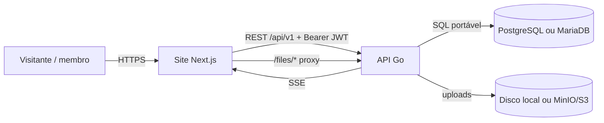

<div align="center">

# Topicly

**O fórum white-label que já vem pronto.**
Instale, escolha o banco, crie a conta do Dono, personalize a identidade — e abra a comunidade.

`Go` · `Next.js 15` · `React 19` · `TypeScript` · `Tailwind` · `PostgreSQL` **ou** `MariaDB` · `Local` **ou** `MinIO/S3`

[Instalação](docs/INSTALL.md) · [Referência da API (OpenAPI)](docs/openapi.yaml) · [Roadmap](ROADMAP.md) · [Contribuir](CONTRIBUTING.md) · [Segurança](SECURITY.md) · [Licença AGPL-3.0](LICENSE)

</div>

---

## Sumário

1. [O que é o Topicly](#o-que-é-o-topicly)
2. [Destaques](#destaques)
3. [Como funciona](#como-funciona)
4. [Arquitetura](#arquitetura)
5. [Começando em 5 minutos](#começando-em-5-minutos)
6. [O site: páginas](#o-site-páginas)
7. [A API: rotas](#a-api-rotas)
8. [Cargos, permissões e hierarquia](#cargos-permissões-e-hierarquia)
9. [Moderação e auditoria](#moderação-e-auditoria)
10. [Personalização (white-label)](#personalização-white-label)
11. [Segurança](#segurança)
12. [Configuração](#configuração)
13. [Testes e qualidade](#testes-e-qualidade)
14. [Estrutura do repositório](#estrutura-do-repositório)
15. [Status do projeto](#status-do-projeto)
16. [Licença e marca](#licença-e-marca)

---

## O que é o Topicly

O Topicly é um **framework de fórum completo**, pensado para ser entregue a clientes
como produto: comunidades, suporte de produtos, grupos de estudo, fãs — qualquer
lugar onde pessoas conversam em tópicos.

Ele não é um esqueleto: categorias, tópicos, respostas aninhadas, curtidas, seguidores,
notificações em tempo real, busca, moderação, painel administrativo com métricas e
um instalador já estão prontos. O que muda de um cliente para outro — nome, logo,
cores, textos, organização da página inicial, cargos — **se configura no painel, sem
tocar no código**.

## Destaques

| | |
|---|---|
| 🧩 **Banco à escolha** | PostgreSQL ou MariaDB com a mesma lógica de negócio (SQL portável + migrations por dialeto). |
| 🚀 **Instalação guiada** | Instalador de linha de comando (banco, armazenamento, segredos) + assistente web `/install` (identidade e conta do Dono). Trava após concluir. |
| 🎨 **White-label de verdade** | Nome, descrição, logo, favicon, cores, arredondamento, redes sociais, rodapé, termos e privacidade — tudo pelo painel. |
| 🧱 **Página inicial montável** | Blocos com ordem, visibilidade, posição (largura total, coluna principal ou lateral), estilo, quantidade e **fonte** (recentes, populares, em alta, destaque, por cargo do autor, por categoria). |
| 🛡️ **Cargos dinâmicos** | Crie cargos e permissões, defina hierarquia. Proteção contra escalonamento de privilégio verificada no servidor. |
| ⚖️ **Moderação completa** | Banimentos e silenciamentos temporários ou permanentes, advertências, central de denúncias e auditoria de toda ação administrativa. |
| 🔔 **Tempo real** | Notificações via SSE (curtidas, respostas, menções `@`, seguidores, novos tópicos, avisos). |
| 📊 **Painel com métricas reais** | Dashboard com contadores e gráficos diário/semanal/mensal — nada é simulado. |
| 🔍 **Busca e descoberta** | Busca global com filtros no banco; seções Em alta, Populares e Recentes. |

## Como funciona



**Ciclo de uma requisição na API:**

1. `RequestID` → `SecurityHeaders` → `IP do cliente` → `Logger` → `Recover` → `CORS`.
2. A rota aplica sua guarda: pública, autenticação opcional, autenticação obrigatória,
   **permissão específica** (`users.ban`, `roles.manage`…), bloqueio de usuários
   **silenciados** em rotas de escrita, ou limite de tentativas.
3. O handler valida o corpo (JSON estrito, **UTF-8 obrigatório**, campos desconhecidos recusados).
4. O serviço aplica as regras de negócio (hierarquia, dono imutável, estado do tópico…).
5. O repositório executa SQL parametrizado, reescrito para o dialeto (`?` → `$1` no PostgreSQL).
6. A resposta sai sempre no mesmo envelope:

```json
{ "success": true, "data": { "...": "..." }, "error": null, "meta": { "total": 42, "page": 1, "limit": 20 } }
```

Erros usam o mesmo formato com `error: { "code": "validation", "message": "..." }` e o
status HTTP correspondente (400, 401, 403, 404, 409, 422, 429).

**Autenticação:** `POST /auth/login` devolve um *access token* JWT (15 min) e um
*refresh token* opaco (30 dias, guardado como hash). O refresh é **rotativo**: cada uso
gera um novo par e revoga o anterior. Banir alguém encerra todas as sessões na hora —
inclusive tokens de acesso ainda válidos.

## Arquitetura

A API é organizada **por domínio**, cada módulo com `handler → service → repository → model`:

| Módulo | Responsabilidade |
|---|---|
| `auth` | cadastro, login, refresh rotativo, logout, middleware JWT e de permissões |
| `user` | perfis, conta, senha, e-mail, avatar e capa |
| `rbac` | cargos, permissões, hierarquia e política anti-escalonamento |
| `category` | categorias e subcategorias (multinível) |
| `topic` | tópicos, respostas aninhadas, curtidas, seguir tópico, histórico de edição |
| `social` | seguir usuários e categorias, contadores |
| `notification` | notificações internas e stream em tempo real (SSE) |
| `search` | busca global com filtros e descoberta |
| `moderation` | banimentos, silenciamentos, advertências e denúncias |
| `audit` | registro e consulta de ações administrativas |
| `site` | configurações white-label, layout e montagem da página inicial |
| `admin` | métricas, séries temporais e listagens do painel |
| `install` | instalador web e trava de instalação |
| `health` | `/health` e `/ready` |

Camadas compartilhadas: `config` (env + `.env` + validação), `database` (conexão, migrations,
reescrita de placeholders, padrões `LIKE` escapados), `storage` (provider local/MinIO,
validação de imagens), `middleware` (cabeçalhos, CORS, logs, limite de taxa) e
`shared` (envelope de resposta, erros de domínio, validações, contexto de autenticação).

## Começando em 5 minutos

```bash
# 1. Prepare o banco e gere o .env (pergunta tudo ou aceita flags)
cd apps/api
go run ./cmd/installer

# 2. Suba a API (lê o .env)
go run ./cmd/server

# 3. Suba o site, apontando para a API
cd ../web
npm install
NEXT_PUBLIC_API_URL=http://localhost:8080 npm run dev
```

Abra `http://localhost:3000`: você será levado ao **assistente de instalação**. Informe o
nome do fórum, a conta do Dono e o `INSTALL_TOKEN` mostrado pelo instalador. Pronto —
você cai no painel com a comunidade no ar.

> Com Docker: `docker compose up` (PostgreSQL por padrão; MariaDB, Redis e MinIO por perfis).
> Guia completo, variáveis e checklist de produção em **[docs/INSTALL.md](docs/INSTALL.md)**.

## O site: páginas

| Rota | O que é |
|---|---|
| `/` | Página inicial montada pelo layout configurável |
| `/categories`, `/c/[slug]` | Categorias, subcategorias e tópicos paginados |
| `/c/[slug]/new` | Criar tópico |
| `/t/[id]` | Tópico com respostas aninhadas, curtir, seguir, denunciar e moderar |
| `/discover` | Em alta, populares e recentes |
| `/search` | Busca global com filtros (autor, categoria, data, respostas, curtidas, ordenação) |
| `/u/[username]` | Perfil público, seguidores/seguindo, tópicos e respostas |
| `/notifications` | Central de notificações (atualiza ao vivo) |
| `/settings` | Configurações: perfil público, conta e segurança |
| `/login`, `/register` | Entrar e criar conta |
| `/install` | Assistente de instalação (só antes de instalar) |
| `/terms`, `/privacy` | Documentos legais editáveis |
| `/admin` | Painel: dashboard, usuários, cargos, banimentos, advertências, categorias, tópicos, respostas, denúncias, identidade visual, página inicial, armazenamento e auditoria |

O painel mostra a cada pessoa **apenas as seções que suas permissões liberam**.

## A API: rotas

Base: `/api/v1`. Legenda — 🌐 pública · 👤 opcionalmente autenticada · 🔒 autenticada ·
🛡️ exige permissão · ✍️ autenticada e bloqueada para silenciados.
A especificação completa (83 operações) está em **[docs/openapi.yaml](docs/openapi.yaml)**,
gerada a partir do código por `node scripts/gen-openapi.mjs`.

<details open>
<summary><b>Instalação, autenticação e conta</b></summary>

| Método | Rota | Acesso | Descrição |
|---|---|---|---|
| GET | `/install/status` | 🌐 | Estado da instalação |
| POST | `/install` | 🌐 | Conclui a instalação (só uma vez; `INSTALL_TOKEN` opcional) |
| POST | `/auth/register` | 🌐 | Cadastro (liberado após a instalação; limite de tentativas) |
| POST | `/auth/login` | 🌐 | Login por usuário ou e-mail |
| POST | `/auth/refresh` | 🌐 | Renova o par de tokens (rotativo) |
| POST | `/auth/logout` | 🌐 | Revoga o refresh token |
| GET | `/me` | 🔒 | Conta, cargos e permissões |
| PATCH | `/me` | 🔒 | Atualização parcial de nome e bio |
| PUT | `/me/password` · `/me/email` | 🔒 | Trocar senha / e-mail (com senha atual) |
| POST | `/me/avatar` · `/me/banner` | 🔒 | Enviar foto de perfil / capa (JPG, PNG, WebP, GIF até 5 MB) |
</details>

<details>
<summary><b>Fórum: categorias, tópicos e respostas</b></summary>

| Método | Rota | Acesso | Descrição |
|---|---|---|---|
| GET | `/categories` · `/categories/{slug}` | 🌐 | Árvore de categorias / uma categoria |
| POST · PATCH · DELETE | `/categories` · `/categories/{id}` | 🛡️ `categories.manage` | Gerenciar categorias |
| GET | `/topics?category=&page=` | 👤 | Tópicos paginados |
| GET | `/topics/{id}` | 👤 | Tópico (conta visualização; indica se você curtiu/segue) |
| POST | `/topics` | ✍️ | Criar tópico |
| PATCH · DELETE | `/topics/{id}` | 🔒 | Editar / excluir (autor ou permissão) |
| PUT | `/topics/{id}/pin` · `/feature` · `/lock` | 🛡️ `topics.pin` / `topics.lock` | Fixar, destacar, bloquear |
| POST | `/topics/{id}/like` · `/follow` | ✍️ | Curtir / seguir (alterna) |
| GET | `/topics/{id}/replies` | 👤 | Respostas paginadas |
| POST | `/topics/{id}/replies` | ✍️ | Responder (inclusive a outra resposta) |
| PATCH · DELETE | `/replies/{id}` | 🔒 | Editar / excluir resposta |
| POST | `/replies/{id}/like` | ✍️ | Curtir resposta |
</details>

<details>
<summary><b>Social, notificações, busca e página inicial</b></summary>

| Método | Rota | Acesso | Descrição |
|---|---|---|---|
| GET | `/users/{username}` | 🌐 | Perfil público |
| GET | `/users/{username}/stats` | 👤 | Contadores e se você segue |
| GET | `/users/{username}/followers` · `/following` | 🌐 | Listas sociais |
| POST | `/users/{username}/follow` · `/categories/{slug}/follow` | ✍️ | Seguir usuário / categoria |
| GET | `/categories/{slug}/stats` | 👤 | Seguidores e tópicos da categoria |
| GET | `/notifications` · `/notifications/unread-count` | 🔒 | Notificações e não lidas |
| GET | `/notifications/stream` | 🔒 | Stream em tempo real (SSE) |
| PUT · DELETE | `/notifications/read-all` · `/notifications/{id}/read` · `/notifications/{id}` | 🔒 | Marcar lida / excluir |
| GET | `/search` | 🌐 | Busca global com filtros |
| GET | `/discover?section=` | 🌐 | Em alta, populares, recentes |
| GET | `/home` | 🌐 | Página inicial pronta: layout + dados de cada bloco |
| GET | `/site/settings` | 🌐 | Identidade white-label pública |
| POST | `/reports` | 🔒 | Denunciar usuário, tópico ou resposta |
</details>

<details>
<summary><b>Administração e moderação</b></summary>

| Método | Rota | Acesso | Descrição |
|---|---|---|---|
| GET | `/admin/metrics` · `/admin/metrics/series` | 🛡️ `metrics.view` | Contadores e séries diária/semanal/mensal |
| GET | `/admin/users` · `/admin/topics` · `/admin/replies` · `/admin/warnings` | 🛡️ | Listagens com busca, filtros, ordenação e paginação |
| GET · POST · PATCH · DELETE | `/admin/roles` · `/admin/roles/{id}` | 🛡️ `roles.manage` | Cargos |
| PUT | `/admin/roles/{id}/permissions` | 🛡️ `roles.manage` | Permissões de um cargo (efeito imediato) |
| GET · POST · PATCH · DELETE | `/admin/permissions` · `/admin/permissions/{id}` | 🛡️ `permissions.manage` | Catálogo de permissões |
| GET · PUT | `/admin/users/{username}/roles` | 🛡️ `roles.manage` | Cargos de um usuário |
| GET | `/admin/users/{username}/moderation` | 🛡️ | Ficha de moderação |
| POST | `/admin/users/{username}/ban` · `/mute` · `/warnings` | 🛡️ `users.ban` / `users.mute` / `warnings.apply` | Banir, silenciar, advertir |
| GET · POST | `/admin/sanctions` · `/admin/sanctions/{id}/revoke` | 🛡️ | Sanções e revogação |
| GET · PATCH | `/admin/reports` · `/admin/reports/counts` · `/admin/reports/{id}` | 🛡️ `reports.manage` | Central de denúncias |
| GET | `/admin/audit` · `/admin/audit/actions` | 🛡️ `logs.view` | Auditoria |
| GET · PUT | `/admin/site/settings` | 🛡️ `settings.manage` | Identidade, textos e layout da home |
| POST | `/admin/site/assets` | 🛡️ `settings.manage` | Enviar logo, favicon e imagens da marca |
| POST | `/admin/notifications` | 🛡️ `settings.manage` | Aviso para todos os membros |
| GET | `/admin/storage` | 🛡️ `storage.manage` | Provedor de armazenamento (sem segredos) |
| GET | `/admin/categories` | 🛡️ `categories.manage` | Todas as categorias, inclusive inativas |
</details>

Também na raiz: `GET /health` (viva) e `GET /ready` (banco acessível); arquivos enviados em `GET /files/*`.

## Cargos, permissões e hierarquia

Três cargos vêm prontos e você cria quantos quiser:

| Cargo | Hierarquia | Padrão |
|---|---|---|
| **Dono** | 100 | Todas as permissões. **Imutável**: ninguém altera o cargo nem a conta do Dono. |
| **Administrador** | 50 | Usuários, moderação, categorias, conteúdo, métricas e logs |
| **Moderador** | 20 | Editar/excluir conteúdo, banir, silenciar, advertir, denúncias |

Regras verificadas **no servidor** (testes em `rbac/policy_test.go`):

- você só gerencia cargos e usuários **abaixo** da sua hierarquia;
- você só concede permissões **que você mesmo possui**;
- ninguém altera os próprios cargos;
- nenhum cargo pode ser criado no nível do Dono;
- `roles.manage` e `permissions.manage` não podem ser desativadas (evita trancar todo mundo para fora);
- mudanças de permissão valem **na próxima requisição** — sem novo login.

## Moderação e auditoria

- **Banimento** (temporário ou permanente): bloqueia login, renovação de sessão e qualquer
  requisição com token ainda válido; encerra todas as sessões.
- **Silenciamento**: a pessoa continua lendo, mas não publica, responde, curte nem segue.
- **Advertências** com histórico; o usuário é notificado.
- **Denúncias** de usuários, tópicos e respostas, com status *pendente → em análise →
  resolvida/rejeitada*; quem denunciou é avisado ao fechar.
- **Auditoria**: toda ação administrativa é registrada com autor, alvo, detalhes, data e IP,
  pesquisável no painel.

## Personalização (white-label)

Tudo abaixo é salvo no banco e aparece no site público na hora:

- **Identidade**: nome, descrição (SEO), logo e favicon (upload).
- **Cores**: cor primária (convertida nos tokens do tema, com contraste automático),
  cor de destaque e arredondamento.
- **Redes sociais e rodapé**: links institucionais no formato `Rótulo|URL`.
- **Documentos legais**: termos de uso e política de privacidade.
- **Página inicial** — o **layout** é uma lista de blocos:

| Bloco | Estilos | Fonte / opções |
|---|---|---|
| Banner principal | grande, compacto | textos, imagem e botão configuráveis |
| Apresentação | texto, cartão | — |
| Estatísticas | grade, lista | contadores reais |
| Categorias | grade, lista | quantidade |
| **Tópicos** | lista, cartões, compacto | recentes · populares · em alta · destaque · **por cargo do autor** · por categoria |
| Membros em destaque | lista, avatares | quantidade |
| Últimas atividades | lista | quantidade |

Cada bloco pode ficar em **largura total**, **coluna principal** ou **coluna lateral**;
blocos seguidos de principal e lateral ficam **lado a lado**. O editor em
`/admin/home` tem reordenação, mostrar/ocultar, adicionar/remover e um mapa da página.

## Segurança

- Senhas com **argon2id**; refresh tokens guardados só como hash e rotativos.
- **SQL 100% parametrizado**; ordenação por lista permitida; padrões `LIKE` escapados.
- Corpo JSON estrito (campos desconhecidos recusados, **UTF-8 obrigatório**, tamanho limitado).
- Uploads verificados pelo **conteúdo** (não pela extensão), limitados a 5 MB.
- Saída sem `innerHTML`: menções e links são montados com segurança no cliente.
- Limite de tentativas em login, cadastro, instalação e denúncias.
- Cabeçalhos defensivos (`X-Content-Type-Options`, `X-Frame-Options`, `Referrer-Policy`, `Permissions-Policy`).
- Em produção, a API **se recusa a iniciar** com segredos JWT padrão, curtos ou iguais.
- O cadastro público fica fechado até a instalação criar o Dono.

## Configuração

As principais variáveis (lista completa em [docs/INSTALL.md](docs/INSTALL.md#variáveis-de-ambiente)):

| Variável | Para quê |
|---|---|
| `DB_DRIVER` | `postgres` ou `mariadb` |
| `DB_HOST`, `DB_PORT`, `DB_USER`, `DB_PASSWORD`, `DB_NAME` | conexão com o banco |
| `STORAGE_PROVIDER` | `local` ou `minio` (+ `MINIO_*`) |
| `JWT_ACCESS_SECRET`, `JWT_REFRESH_SECRET` | segredos dos tokens (gerados pelo instalador) |
| `APP_ENV` | `production` ativa as validações de segurança |
| `CORS_ALLOWED_ORIGINS` | domínios do site |
| `INSTALL_TOKEN` | protege o assistente `/install` |
| `NEXT_PUBLIC_API_URL` | (site) endereço da API |

## Testes e qualidade

```bash
cd apps/api && go test ./...          # testes unitários (políticas, validações, séries, layout…)
scripts/e2e.sh http://localhost:8080   # 62 verificações ponta a ponta contra uma API rodando
cd apps/web && npx tsc --noEmit        # checagem de tipos do site
node scripts/gen-openapi.mjs           # regenera a referência da API
```

O roteiro e2e cobre RBAC e anti-escalonamento, banimento/silenciamento/revogação,
denúncias, auditoria, métricas, listagens, identidade visual e uploads.

## Estrutura do repositório

```
apps/
  api/                 API Go
    cmd/server/        servidor HTTP
    cmd/installer/     instalador de linha de comando
    internal/
      config/          variáveis, .env e validação
      database/        conexão, migrations, dialetos
      middleware/      cabeçalhos, CORS, logs, limite de taxa
      modules/         auth, user, rbac, category, topic, social, notification,
                       search, moderation, audit, site, admin, install, health
      server/          composição, rotas e guardas
      shared/          envelope, erros, validações, contexto
      storage/         disco local e MinIO/S3
    migrations/        postgres/ e mariadb/ (mesmas versões)
  web/                 site Next.js (App Router)
    app/               páginas públicas, /settings, /install e /admin/*
    components/        UI, blocos da home, painel
    lib/               clientes da API, tema, utilitários
docs/                  INSTALL.md e openapi.yaml
scripts/               e2e.sh e gen-openapi.mjs
```

## Status do projeto

| Etapa | Entrega | Status |
|---|---|---|
| 1 | Fundação: monorepo, API, site, migrations, Docker | ✅ |
| 2 | Autenticação, perfis, uploads, RBAC base | ✅ |
| 3 | Fórum: categorias, tópicos, respostas, curtidas, seguir | ✅ |
| 4 | Social, notificações em tempo real, busca, descoberta | ✅ |
| 5 | Moderação, cargos dinâmicos, denúncias, auditoria | ✅ |
| 6 | Painel administrativo, métricas, white-label | ✅ |
| 7 | Instalador, segurança, documentação, testes | ✅ |

Validado ponta a ponta em PostgreSQL, incluindo uma instalação limpa do zero. O suporte a
MariaDB está implementado (migrations e consultas para os dois dialetos); a rodada
completa de verificação em MariaDB está pendente.

> **Observações de operação:** o tempo real usa um hub em memória (sem Redis) — com várias
> instâncias da API, cada uma entrega só às próprias conexões. O estado de banimento e
> silenciamento fica em cache por até 15 s por instância.

## Licença e marca

O Topicly é software livre sob a **[GNU AGPL-3.0](LICENSE)** — veja também o [NOTICE](NOTICE).
Se você modificar o Topicly e oferecê-lo pela rede, precisa disponibilizar o código-fonte
da sua versão aos usuários (seção 13 da AGPL).

| Documento | Conteúdo |
|---|---|
| [LICENSE](LICENSE) | Texto integral da GNU AGPL-3.0 |
| [NOTICE](NOTICE) | Direitos autorais e componentes de terceiros |
| [TRADEMARK.md](TRADEMARK.md) | Uso da marca Topicly (o white-label do seu fórum continua livre) |
| [CONTRIBUTING.md](CONTRIBUTING.md) | Como contribuir |
| [SECURITY.md](SECURITY.md) | Como reportar vulnerabilidades |
| [PRIVACY.md](PRIVACY.md) | Sem telemetria; dados ficam na sua instalação |
